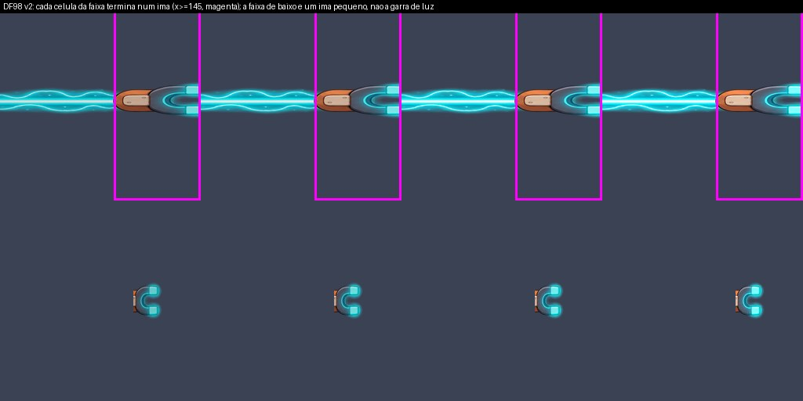
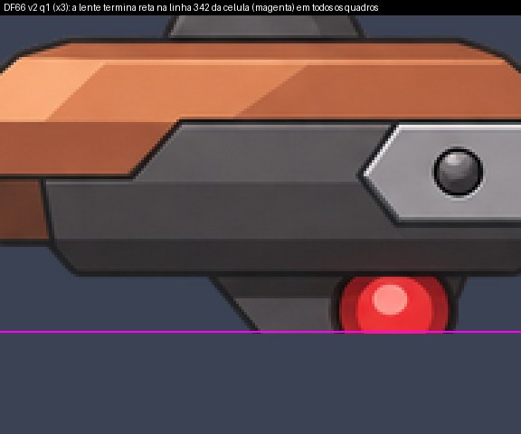
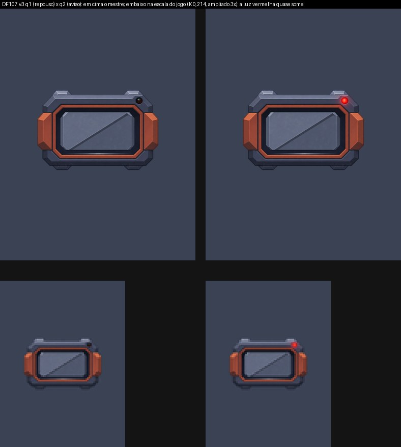
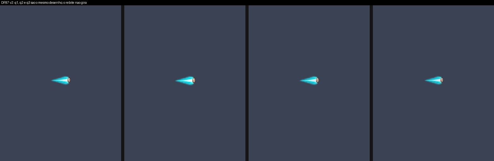
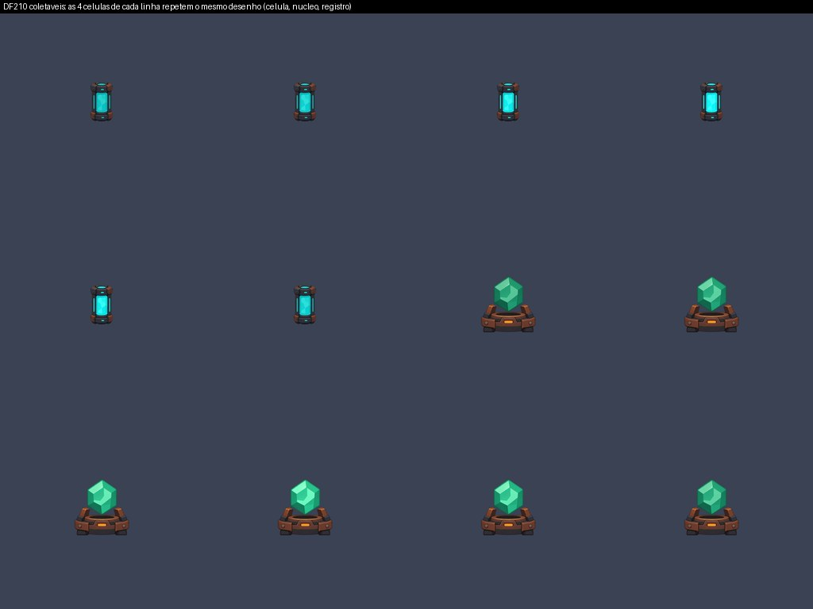
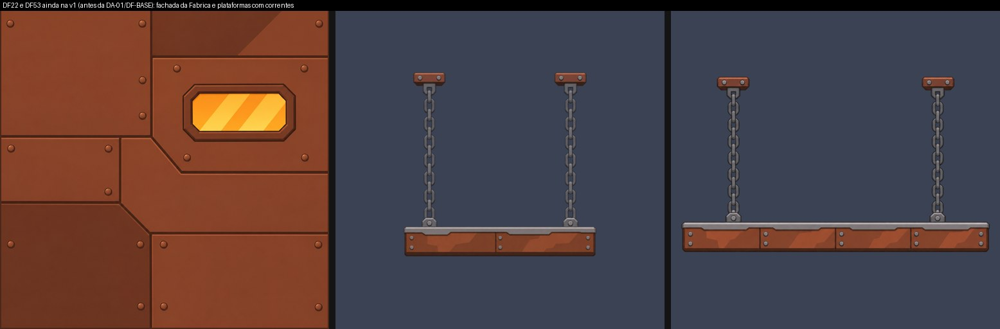
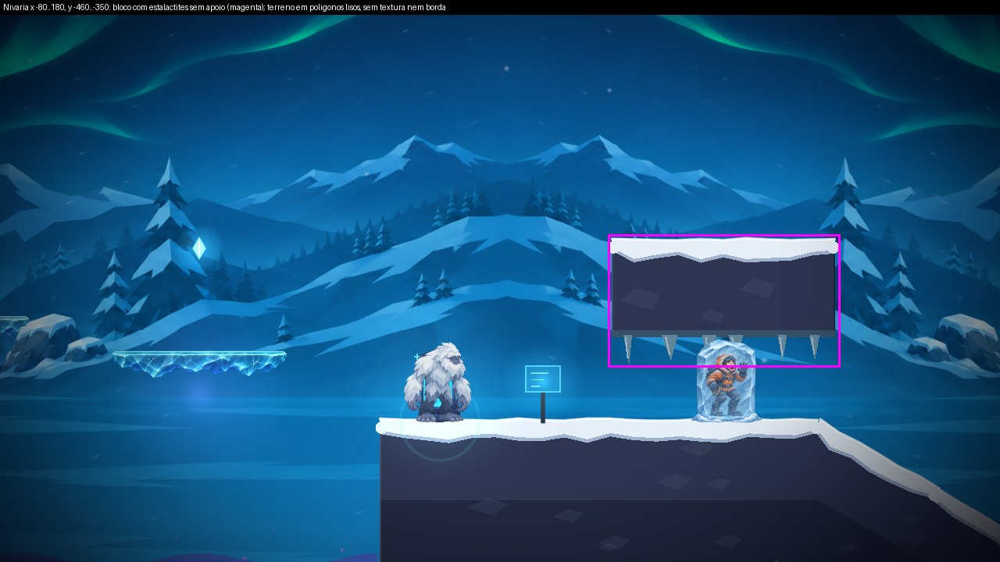

# Pedidos de arte da revisão geral (REV-01 a REV-09)

**Estado:** ABERTOS (27/11/2026). Saíram da revisão geral da branch `dev/revisao-geral` ([relatório](../../docs/revisao_geral/RELATORIO.md)).
**Para:** quem for produzir a arte (qualquer artista) · **De:** Claude (desenvolvimento)
**Diretrizes:** DA-01, DA-02, DA-03, DA-04 e a bíblia **DF-BASE** ([DF_pacote_completo_v2.md](DF_pacote_completo_v2.md), seção 2). Em conflito, vale a diretriz.

## Como usar

1. Cole primeiro o bloco **[DF-BASE]** do pacote v2 (seção 2) e depois o prompt da peça. O DF-BASE traz a paleta (aço azul-acinzentado, cobre ferrugem, âmbar `#EFAA55`, vermelho só para perigo, ciano `#2EC7E6` só para o que o Ímã pega), o contorno frio e parcial só nas figuras e o sombreamento chapado em 2–3 tons.
2. Cada pedido diz o problema (com a captura em `docs/revisao_geral/capturas/pedidos/`), o formato, a grade, os quadros, as âncoras e onde a peça entra. Nada aqui muda a jogabilidade: as medidas são as que o jogo já usa.
3. O João aprova; a peça sobe em `colaboracao/entregas/<ID>/` com sufixo novo (`_v3` ou `_rev`), um `ENTREGA` com o SHA-256 e a linha do `colaboracao/STATUS.md` atualizada. O desenvolvimento integra e tira o paliativo indicado em cada pedido.

**Ordem sugerida:** REV-02 e REV-03 (leitura de combate) → REV-01 (feixe do Ímã, o jogador vê o tempo todo) → REV-09 (a Nivária inteira usa o terreno) → REV-04 e REV-05 (animações paradas) → REV-06 → REV-07 → REV-08.

**O que não precisa de pedido** (resolvido sem desenho, por `tools/tratar_arte_revisao.py`): DF91 (fragmentos e quatro quadros desenhados 35–36 px acima dos pés) e DF96 (fragmentos). DF103, DF104 e DF105 foram resolvidos pela Forja-Mãe v3.

| ID | Peça | Problema | Paliativo no jogo hoje | Prioridade |
|---|---|---|---|---|
| REV-01 | DF98 feixe do Ímã | cada célula termina num ímã; a ponta é um ímã, não a garra | recorta x 0–140 e usa a ponta da v1 | B |
| REV-02 | DF66 e DF68 q3, drone | lente cortada reta na linha 342 | nenhum (lente sem a parte de baixo) | B |
| REV-03 | DF107 escotilha da Forja | luz do aviso tem ~4 px no jogo | tinta vermelha nas escotilhas (`forja.gd`, `_update_drones`) | B |
| REV-04 | DF87 rebite | 3 dos 4 quadros iguais: não gira | gira o sprite pela direção | C |
| REV-05 | DF210 coletáveis | as 4 células de cada linha são o mesmo desenho | brilho e balanço por código | C |
| REV-06 | DF200 céu diurno | PNG corrompido (CRC do 6º bloco) | recomposição de `tools/import_deserto_v2.py` | C |
| REV-07 | DF22 e DF53 | fachada da Fábrica e plataformas com correntes ainda na v1 | correntes com escala uniforme (revisão) | C |
| REV-08 | DF108 grade da Forja | pulsos 1/2/6 e 3/4/5 quase iguais: o fogo mal pulsa | nenhum | C |
| REV-09 | Nivária: terreno e bloco suspenso | terreno em polígonos lisos desenhados por código, sem textura nem borda; bloco com estalactites sem apoio | nenhum | B |

---

## REV-01 · DF98 Feixe do Ímã (segmento repetível e ponta)



````markdown
**[REV-01 · DF98 v3] Feixe do Ímã de Fase (segmento repetível e ponta)**

(Cole antes o bloco [DF-BASE].)

- **ID:** DF98 v3
- **Arquivo:** `DF98_feixe_ima_v3.png`, em `colaboracao/entregas/DF98/`.
- **Problema da v2:** na faixa de cima, cada célula de 256 × 256 termina num ímã desenhado (x ≥ 145), então o segmento não pode ser repetido: a cada 256 px aparece um ímã no meio do feixe. Na faixa de baixo, a "ponta" é um ímã pequeno, e não a garra de luz pedida. Captura: `docs/revisao_geral/capturas/pedidos/REV-01_DF98.jpg`.
- **Finalidade no jogo:** feixe entre o braço do Autômato (DF97) e a argola (DF57) ou o drone puxado. O jogo repete o segmento até a distância certa e gira tudo na direção do alvo.
- **Referências do repositório:** `colaboracao/entregas/DF97/` (braço-ímã, de onde o feixe sai), `colaboracao/entregas/DF57/` (argola com anel ciano), `colaboracao/entregas/DF99/` (pulso, mesma família de efeito).
- **Formato:** PNG RGBA de **1024 × 512**, duas faixas de 4 quadros de 256 × 256.
  - linhas 0–255: **segmento repetível**, 4 quadros em loop, ondas de força correndo para a direita. Só feixe: **nenhum ímã, braço ou garra** dentro da célula. A borda esquerda de cada quadro continua exatamente a direita (teste com três cópias lado a lado).
  - linhas 256–511: **ponta**, 4 quadros em loop: o feixe se fecha numa garra de luz que abraça o alvo.
- **Âncoras:** eixo do feixe em y 128 (faixa de cima) e y 384 (faixa de baixo). Na ponta, o ponto de contato fica em x 200 de cada quadro.
- **Escala:** espessura de 48 px no mestre (0,12 D).
- **Cor:** linhas de força ciano `#2EC7E6` e branco, pequenos anéis magnéticos; nada de laser liso. Efeito sem contorno escuro (é luz).
- **Antes de entregar, confira:** três cópias do segmento lado a lado sem emenda; nenhum pixel com alfa > 0 fora de y 104–152 na faixa de cima.
- **No jogo, depois da entrega:** sai o recorte x 0–140 e a ponta da v1 (`tools/import_deserto_v2_folhas.py` e `scripts/player.gd`, feixe do Ímã).
````

## REV-02 · DF66 e DF68 Drone do Deserto: lente inteira



````markdown
**[REV-02 · DF66 v3 e DF68 v3] Drone do Deserto: lente inteira**

(Cole antes o bloco [DF-BASE].)

- **IDs:** DF66 v3 (voo, 6 quadros) e DF68 v3 (tiro, 3 quadros).
- **Arquivos:** `DF66_drone_voo_v3.png` e `DF68_drone_tiro_v3.png`, em `colaboracao/entregas/DF66/` e `DF68/`.
- **Problema da v2:** a lente vermelha de baixo termina **cortada reta na linha 342** da célula em todos os quadros da DF66 e no quadro 3 da DF68 (que é cópia do quadro 1 da DF66). A lente ocupa x 223–255, y 322–342 e acaba numa linha reta, como se a célula a cortasse. Não existe outro quadro com a lente inteira para recompor. Captura: `REV-02_DF66.jpg`.
- **Finalidade no jogo:** é o "olho" do drone e é dele que o tiro sai (o jogo usa a lente como origem do tiro: (±10, +13) px do centro do drone no jogo).
- **Formato:** igual à v2. PNG RGBA 1536 × 1024, grade 4 × 2 de células 384 × 512; DF66 com 6 quadros (as 2 últimas células vazias), DF68 com 3.
- **Âncora:** centro do drone em (192, 256), como na v2. A lente fica onde está hoje, centro em ~(241, 333), mas **redonda e inteira**, com o arco de baixo fechado e o contorno do corpo continuando por baixo dela.
- **O que muda:** só a lente e o casco logo em volta dela. Silhueta, hélices, pose e tempo dos quadros continuam os da v2.
- **Antes de entregar, confira:** em nenhum quadro há pixel opaco cortado por uma linha horizontal reta; sobreponha cada quadro v3 ao v2 e veja que só a região da lente mudou.
````

## REV-03 · DF107 Escotilha da Forja-Mãe: aviso legível



````markdown
**[REV-03 · DF107 v4] Escotilha da Forja-Mãe: aviso legível na escala do jogo**

(Cole antes o bloco [DF-BASE].)

- **ID:** DF107 v4
- **Arquivo:** `DF107_forja_escotilha_v4.png` (mestre) e `DF107_jogo_v4.webp` (mestre reduzido a 50 %), em `colaboracao/entregas/DF107/`.
- **Problema da v3:** o aviso (quadro 2) é uma luz vermelha de ~20 px no mestre; na escala do jogo (K 0,214) ela vira ~4 px e a diferença média entre o repouso (q1) e o aviso (q2) é de 0,08 nível. O jogador não percebe que as escotilhas vão soltar drones. Captura: `REV-03_DF107.jpg`.
- **Finalidade no jogo:** as duas escotilhas do corpo da Forja (encaixes de 240 × 160 em (640, 820) e (1408, 820) do DF100) avisam, abrem e soltam drones.
- **Formato:** igual à v3 (grade, células, quantidade e ordem de quadros e âncoras do `DF100_atlas_v3.json`). Só o quadro 2 muda.
- **Quadro 2 (aviso):** o vidro inteiro ganha um brilho vermelho de perigo e as bordas internas acendem em faixas vermelhas, ocupando pelo menos 30 % da área da escotilha. Vermelho é a cor de perigo do DF-BASE.
- **Antes de entregar, confira:** reduza q1 e q2 a 21,4 % e compare: o aviso tem que ser óbvio nesse tamanho.
- **No jogo, depois da entrega:** sai a tinta vermelha das escotilhas em `scripts/forja.gd` (`_update_drones`, comentário "Pedido REV-03").
````

## REV-04 · DF87 Rebite: giro de verdade



````markdown
**[REV-04 · DF87 v3] Rebite (projétil do Autômato): giro em 4 quadros**

(Cole antes o bloco [DF-BASE].)

- **ID:** DF87 v3 · **Arquivo:** `DF87_rebite_v3.png`, em `colaboracao/entregas/DF87/`.
- **Problema da v2:** os quadros 1, 2 e 3 são o mesmo desenho (só o 4 muda): no jogo o rebite voa parado. Captura: `REV-04_DF87.jpg`.
- **Finalidade:** projétil da Rebitadeira do Autômato. O jogo gira o sprite na direção do tiro; a animação é o giro do rebite no próprio eixo.
- **Formato:** igual à v2. PNG RGBA 1536 × 1024, grade 4 × 2 de células 384 × 512, 4 quadros na primeira linha, âncora (192, 256), rebite de 40 px de comprimento (0,1 D), deitado, apontando para a direita.
- **Quadros:** 1 a 4 = um quarto de volta cada (0°, 90°, 180°, 270° em torno do eixo do rebite, lido pela luz da cabeça e pelo brilho do corpo). Loop.
- **Antes de entregar, confira:** os quatro quadros diferentes entre si; a silhueta não se confunde com o projétil do robô (DF70).
````

## REV-05 · DF210 Coletáveis do Deserto: animação



````markdown
**[REV-05 · DF210 v3] Coletáveis do Deserto: célula, núcleo e registro animados**

(Cole antes o bloco [DF-BASE].)

- **ID:** DF210 v3 (coletáveis) · **Arquivo:** `DF210_coletaveis_v3.png`, em `colaboracao/entregas/DF210/`.
- **Problema:** nas três linhas da folha, as quatro células repetem o mesmo desenho (diferença média de 0,0 a 0,2 nível; só os núcleos 3–4 variam). No jogo os coletáveis ficam parados, com o brilho e o balanço que o código põe por cima. Captura: `REV-05_DF210.jpg`.
- **Formato:** igual à v2. PNG RGBA 2048 × 1536, grade 4 × 3 de células 512 × 512, âncora no centro (256, 256).
  - linha 1, **célula de energia**: 4 quadros em loop, a carga âmbar `#EFAA55` sobe e desce dentro do vidro.
  - linha 2, **Núcleo de Integridade**: 4 quadros em loop, o núcleo gira um quarto de volta por quadro.
  - linha 3, **registro**: 4 quadros em loop, a tela pisca uma linha de texto ilegível (sem letras reais).
- **Mantenha:** silhueta, tamanho e cores da v2. O brilho em volta continua sendo do jogo, não desenhe halo.
````

## REV-06 · DF200 Céu diurno: arquivo íntegro

````markdown
**[REV-06 · DF200] Céu diurno das Dunas: reenviar o arquivo íntegro**

- **ID:** DF200 · **Arquivo:** `DF200_ceu_diurno.png`, em `colaboracao/entregas/DF200/` (substitui o atual).
- **Problema:** o arquivo na `main` (SHA `4ef56118…`) tem o 6º bloco de dados com CRC inválido: só as linhas 0–579 de 1.440 decodificam e o Godot não abre. Não é desenho novo: é exportar de novo o céu já aprovado. Detalhe em `docs/fases/deserto_ferrugem/integracao_arte_v2.md`, seção "DF200 diurno".
- **Formato:** o aprovado (largura e altura do original, PNG RGBA).
- **Antes de entregar, confira:** `python -c "from PIL import Image; Image.open('DF200_ceu_diurno.png').load()"` roda sem erro; anote o SHA-256 novo no ENTREGA.
- **No jogo, depois da entrega:** sai a recomposição de `tools/import_deserto_v2.py`.
````

## REV-07 · DF22 e DF53: fachada da Fábrica e plataformas suspensas na v2



````markdown
**[REV-07 · DF22 v2 e DF53 v2] Fachada da Fábrica e plataformas com correntes**

(Cole antes o bloco [DF-BASE].)

- **IDs:** DF22 v2 (parede externa da Fábrica) e DF53 v2 (plataformas suspensas, pequena e grande).
- **Arquivos:** `DF22_parede_fabrica_externa_v2.png`, `DF53a_plataforma_pequena_v2.png`, `DF53b_plataforma_grande_v2.png`.
- **Problema:** as duas peças ainda são da v1 (antes da DA-01 e do DF-BASE) e ficaram fora dos pacotes 11–20. A DF22 é uma chapa de cobre saturado de ponta a ponta, sem o aço azul-acinzentado das paredes v2 (DF202), com frisos escuros entre as chapas e uma janela âmbar listrada; ao lado das peças v2 da Fábrica, parece de outro artista. As DF53 têm a laje e as correntes no traço da v1. Captura: `REV-07_DF22_DF53.jpg`.
- **DF22:** 512 × 512, módulo que repete na horizontal e na vertical (a borda esquerda continua a direita e a de cima continua a de baixo). Cenário: **sem contorno**, 2–3 tons por superfície, aço azul-acinzentado com chapas de cobre ferrugem, como as paredes da DF202.
- **DF53a e DF53b:** 1024 × 1024 cada, mesma composição da v1: laje de aço com **duas correntes** e o suporte de cada uma em cima, com as correntes **no mesmo x da v1**, porque o jogo continua cada corrente com um tirante até o teto a partir dali. A laje é objeto de apoio: contorno frio e parcial (DA-04).
- **Antes de entregar, confira:** repita a DF22 em 3 × 2 sem emenda; sobreponha a DF53 v2 à v1 e veja que as correntes caem no mesmo x.
- **No jogo, depois da entrega:** `scripts/desert.gd` (`_montar`, correntes das plataformas) só troca a textura.
````

## REV-08 · DF108 Grade da Forja-Mãe: fogo que pulsa

````markdown
**[REV-08 · DF108 v4] Grade da Forja-Mãe: pulso do fogo visível**

(Cole antes o bloco [DF-BASE].)

- **ID:** DF108 v4 · **Arquivos:** `DF108_forja_grade_v4.png` e `DF108_jogo_v4.webp`, em `colaboracao/entregas/DF108/`.
- **Problema da v3:** os pulsos 1, 2 e 6 e os pulsos 3, 4 e 5 são quase iguais entre si, então o fogo atrás da grade alterna entre dois estados em vez de pulsar. Detalhe em `docs/revisao_geral/auditoria_forja_v3.md`.
- **Formato:** igual à v3 (grade, células, âncoras do `DF100_atlas_v3.json`). Encaixe de 700 × 240 em (1024, 1820) do DF100.
- **Quadros 1 a 6:** o fogo âmbar `#EFAA55` cresce do q1 ao q3, chega ao máximo no q4 e baixa no q5 e no q6, com as línguas de fogo mudando de forma a cada quadro. Loop.
- **Antes de entregar, confira:** cada quadro difere do anterior em pelo menos 2 níveis médios na região do fogo, também reduzido a 21,4 %.
````

## REV-09 · Nivária: arte do terreno e apoio do bloco suspenso



Este pedido é da fase do Caio (a Nivária que entrou pela `dev/neve-fase`). Combine com ele antes de produzir: ele pode já ter isso em andamento.

````markdown
**[REV-09 · NV-TERRENO] Nivária: módulos de terreno (rocha com neve e gelo)**

(Cole antes o bloco [DF-BASE], trocando a cor-assinatura âmbar pela da Nivária: azul-gelo, como em `assets/nivaria/Cenario 1.png`.)

- **ID:** NV-TERRENO · **Arquivos:** uma folha PNG RGBA de módulos, em `colaboracao/entregas/NV-TERRENO/`.
- **Problema:** o terreno da Nivária é desenhado por código: polígonos em três tons de ardósia (`C_ROCHA` em `scripts/nivaria.gd`: `#1E2338`, `#2E3550`, `#535D78`) com poucas facetas e uma faixa de neve por cima. Laboratório, Verdâmia e Deserto têm terreno desenhado, com textura, borda de apoio e cantos. Ao lado dos personagens e do fundo pintado, a Nivária parece inacabada. Os arquivos `assets/nivaria/chao.png` e `sem neve.png` não servem: são faixas de chão contínuas (gelo e terra marrom) noutra linguagem e não são usados pelo jogo.
- **Onde entra:** todos os blocos e encostas da cena `fases/nivaria.tscn` (nós de bloco com `estalactites`, `sem_neve` etc.; o código que desenha está em `scripts/nivaria.gd`).
- **Módulos pedidos** (2× do jogo, como a DF205 do Deserto, que serve de modelo de grade e encaixe):
  - **rocha** repetível em X e Y (256 × 256), sem contorno, 2–3 tons frios;
  - **topo com neve** repetível em X (256 × 96), linha de apoio em y 32;
  - **cantos com neve**, esquerdo e direito (128 × 128), quina em (18, 32) e (110, 32);
  - **borda de baixo com estalactites**, grandes e pequenas (256 × 96), repetível em X, para os blocos marcados com `estalactites` e `estalactites_pequenas`;
  - **encosta** com neve (topo inclinado a 30°, 256 × 256), para os nós `Encosta` e `Descida`.
- **Antes de entregar, confira:** três cópias de cada módulo repetível lado a lado sem emenda; a linha de apoio de topo e cantos na mesma altura.

**Junto, para o level design (sem arte):** o bloco de x −80 a 180, y −460 a −350 (com estalactites, acima do alpinista preso no gelo) não se apoia em nada. Precisa de uma ligação com o teto ou com a encosta (pilar de rocha ou parede), ou virar ponto de gancho com a argola à vista. Decisão do Caio.
````
