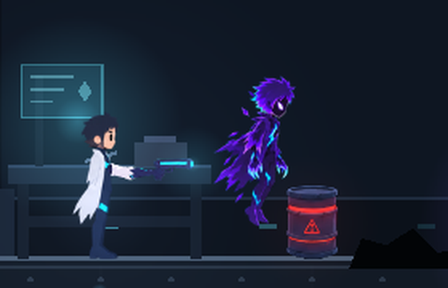
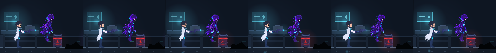
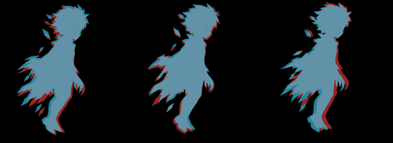

# Revisão A2_eco_float: Eco pairando (loop)

**Resultado:** ✅ **APROVADO e INTEGRADO como asset.** Ainda não está em uso no gameplay, porque a Fuga do Eco não foi implementada.
**Revisor:** Claude (desenvolvimento)
**Entrega revisada:** commit `2dea5421189edf7680c602997e7e7b9cd8bd041e`, arquivo `colaboracao/entregas/A2_eco_float/A2_eco_float.png`
**SHA-256 conferido:** `5fd47c23d0513182e030a17c4ba6b7ac26298007c7892682785f45bdb0765a95`, igual ao do `ENTREGA.md`
**Teste em Godot:** 4.3, renderer Compatibility, Laboratório Hélix, ao lado do Daymon idle, a 8 fps, com câmera do jogo (zoom 1,1)

## Verificações técnicas

| Item | Resultado | Medição |
|---|---|---|
| Dimensões e modo | ✅ | 1536 × 1024, RGBA |
| Transparência | ✅ | Alfa 0 fora da figura. Bordas com alfa gradual (cerca de 18% dos pixels da figura são semitransparentes, o que é esperado no antialias) |
| Grade 4 × 2, 6 quadros | ✅ | Células 1 a 6 ocupadas e 7 e 8 vazias. Nenhum quadro toca a borda da célula nem invade a vizinha |
| Linha de flutuação | ✅ | Base dos quadros: y 392, 388, 384, 388, 392, 396, exatamente o ciclo pedido (120 px da borda na base, ±8 px) |
| Movimento vertical da cabeça | ✅ | Olho em y 88,7 → 84,1 → 82,2 → 84,3 → 88,3 → 93,6. Acompanha a oscilação do corpo, com desvio de até 2 px do ideal |
| Transição 6 → 1 | ✅ | Olho sobe 4,9 px, igual aos outros passos. Sem salto, confirmado em onion skin |
| Estabilidade horizontal | ⚠️ pequena | Cabeça entre x 218 e 225 (±3,5 px). O tronco do **quadro 3** está cerca de **8–10 px à direita** dos demais (x 166 contra 156–160) |
| Franja verde do chroma key | ⚠️ mínima | 1.570 pixels levemente esverdeados, todos com alfa ≤ 93 (média 17). Invisível no jogo. A importação neutraliza esses pixels automaticamente |
| Altura da figura | ✅ | 380 px em todos os quadros (consistente) |

## Escala relativa ao Daymon

O pedido citava "cerca de 400 px, como nas sheets do Daymon". As sheets do Daymon não são uniformes: a corrida tem cerca de 410 px e o idle tem 488 px. **Não é um defeito da arte.** A escala final é aplicada na importação: o Eco foi ajustado para ficar com a **mesma altura do Daymon idle no jogo** (escala de textura 0,3853 e escala de nó 0,58, igual à do Daymon). Ele paira cerca de 18 px acima do chão.

Para as próximas animações do Eco, **o que importa é manter a mesma escala de desenho da A2**: a figura mede 380 px na pose de pairar. Os pedidos A1, A3, A4, A5 e A9 foram atualizados com essa regra.

## Leitura no jogo

- A silhueta é legível em escala real. O Eco se destaca do fundo escuro do laboratório pelo contorno ciano e pelos olhos.
- Fica claro que ele é "um Daymon": mesma altura, cabeça e cabelo em linguagem coerente.
- O loop a 8 fps é suave. As pequenas variações de recorte do jaleco entre os quadros dão vida e não piscam.

Onion skin (vermelho = primeiro quadro, ciano = segundo) para as transições 6→1, 1→2 e 3→4:

## Ressalvas do ENTREGA.md

| Ressalva do diretor de arte | Avaliação |
|---|---|
| Altura 380 px em vez de cerca de 400 | Aceita, porque a escala é resolvida na importação (veja acima) |
| Eixo estimado pelo peito, sem pivô validado | Aceita. A âncora usada é um ponto fixo da célula (x 192, y 472), e a oscilação horizontal medida é pequena |
| Microgestos não garantidos (dedos fechando no quadro 5, pulso ciano no quadro 3, aura expandindo) | Aceita: não bloqueia. São detalhes que não se percebem em escala de jogo. Fica como melhoria opcional |
| Névoa difusa removida | Correto pela DA-01 (efeitos contidos) |

## Ajustes opcionais (não bloqueiam)

1. **Quadro 3:** o tronco está deslocado cerca de 8 px para a direita em relação aos quadros 2 e 4. No jogo isso dá cerca de 2 px de tremida horizontal, quase imperceptível. Se houver uma nova versão (`_v2`), recentralize o quadro 3 para que a nuca fique em x ≈ 218, como nos quadros 2 e 4.
2. Nas próximas entregas com chroma key, faça um despill (remover o verde das bordas semitransparentes) antes de publicar. A importação já faz isso, mas fica mais limpo na origem.

## Integração feita

- `tools/import_cells.py` (novo): importa entregas em grade 4 × 2 transparente, faz o despill, aplica a escala e gera o atlas e os SpriteFrames. **O PNG da entrega não é alterado.**
- `assets/inimigos/eco/eco_sheet.png` e `eco_frames.tres`: animação `float`, 6 quadros, 8 fps, em loop.
- `scripts/sprite_meta_cells.gd` (gerado): `ECO_FRAMES`, `ECO_OFFSET` e `ECO_TEX_SCALE`.
- `arte_original/USADAS_NO_JOGO.md` atualizado.
- **Nenhuma lógica de jogo foi alterada.** O Eco entra no gameplay junto com a Fuga do Eco, quando a locomoção (A3) também estiver pronta.
